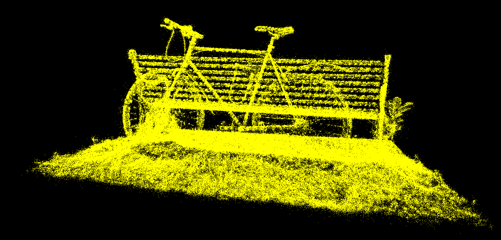
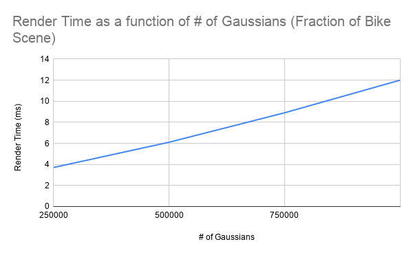

# Project5-WebGPU-Gaussian-Splat-Viewer

**University of Pennsylvania, CIS 565: GPU Programming and Architecture, Project 5**

* Aidan Gideon
* Tested on: **Firefox 159.0** on
  Windows 10, Ryzen 5 3600 @ 3.59GHz 32GB RAM, Radeon RX 5700XT

### Results

VIDEO HERE

### Live Demo

### Overview

This is a realtime 3D Gaussian Splat viewer in **WebGPU**.  It takes in pre-trained gaussian data and renders it by splatting each gaussian to the screen.  It's basically a ton of blurry ellipsoids forming the illusion of a 3D scene.  It converts the gaussians from a **global quaternion** representation to a **2D covariance** representation of the splatted gaussian in screenspace.  This splatting is done every frame in a compute shader after which the splatted gaussians are **radix sorted** by depth and rendered using rasterization with alpha blending.

### Performance Analysis

#### Point Cloud vs Gaussian Splatting

.png)

The point cloud rendering is much cheaper since we're just rasterizing very small points with almost no compute overhead.

The gaussian rendering, on the other hand, is fairly expensive since every frame, we have to run a compute shader that, for each gaussian, computes a 2D covariance matrix.  We also have to sort the gaussians and render them as quads instead of points.  The larger the gaussian quads are, the more time rasterization will take.

#### Number of Gaussians

Changing the number of gaussians linearly scales the time per frame since the amount of work needed is linear with respect to number of gaussians.

The below table shows the visual of the scene with respect to number of gaussians.

| 25% | 50% | 75% | 100% |
| --- | --- | --- | --- |
|  |  |  |  |

#### Frustum Culling

Frustum culling is very helpful for when we're zoomed in or looking away from the scene, but because our scenes are compact, every gaussian is usually in the view frustum.

#### Gaussian Size

The larger the gaussian, the larger the quad needed to draw it, the more fragments that need to be considered, the longer rendering takes.

| Extra small Gaussians | Normal Gaussians | Extra large Gaussians |
| --- | --- | --- |
|  |  |  |

#### Workgroup Size

Changing workgroup size didn't change performance in any noticeable way, likely because the Gaussian compute shader doesn't take advantage of shared memory and our workgroup size isn't small enough to hit the limit for workgroups per SM; we get high occupancy regardless of workgroup size.

### Credits

- [Vite](https://vitejs.dev/)
- [tweakpane](https://tweakpane.github.io/docs//v3/monitor-bindings/)
- [stats.js](https://github.com/mrdoob/stats.js)
- [wgpu-matrix](https://github.com/greggman/wgpu-matrix)
- Special Thanks to: Shrek Shao (Google WebGPU team) & [Differential Guassian Renderer](https://github.com/graphdeco-inria/diff-gaussian-rasterization)
